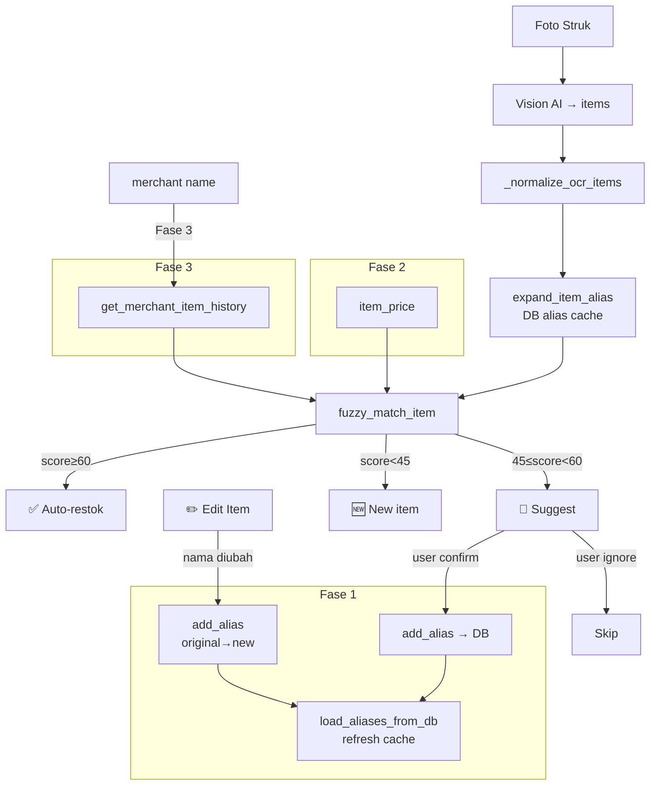

# OCR Matching — Peningkatan Akurasi Inventory Restok

> **For Hermes:** Use subagent-driven-development to implement task-by-task.

**Goal:** Meningkatkan akurasi matching antara item hasil OCR struk dengan inventory database — mengurangi false positive, auto-learn alias dari koreksi user, dan menggunakan harga sebagai signal matching tambahan.

**Architecture:** Tiga fase bertahap:
1. Alias auto-learning — setiap kali user confirm/ignore match suggestion, simpan sebagai alias di DB
2. Price-aware scoring — gunakan `lastPurchasePrice` sebagai signal matching tambahan
3. Merchant-aware boosting — weight item berdasarkan history pembelian per merchant

**Tech Stack:** Python, rapidfuzz, Supabase REST API (pos.inventory.aliases JSONB column, pos_purchase_logs table)

---

## Fase 1: Alias Auto-Learning

### Task 1.1: Tambah method `add_alias` di InventoryManager

**Objective:** Bisa nambah alias ke inventory item via REST API PATCH (update JSONB array)

**Files:**
- Modify: `/opt/djiwatentramapp/yumi-finance-agent/inventory.py` (after `log_purchase`, before menu stock sync section)

**Step 1: Baca struktur kolom aliases**

```python
# Cek dulu struktur aliases di DB
# Kolom: pos.inventory.aliases = text[] atau jsonb
# Dari item_normalization.py: aliases_data pakai format list of strings
```

**Step 2: Tambah method `add_alias`**

```python
async def add_alias(self, inventory_id: str, new_alias: str) -> bool:
    """Tambah alias ke inventory item. Append ke array aliases jika belum ada.
    
    Args:
        inventory_id: _id dari item di pos.inventory
        new_alias: alias name to add
        
    Returns:
        True jika berhasil
    """
    new_alias = (new_alias or "").strip()
    if not new_alias or not inventory_id:
        return False
    
    # Pakai service_role_key + Accept-Profile: pos untuk akses snake_case
    url = f"{self.supabase_url}/rest/v1/inventory?_id=eq.{inventory_id}"
    headers = {
        "apikey": self.supabase_key,
        "Authorization": f"Bearer {self.service_role_key}",
        "Accept-Profile": "pos",
        "Content-Type": "application/json",
        "Prefer": "return=representation",
    }
    
    # Ambil aliases existing dulu
    async with httpx.AsyncClient(timeout=10) as client:
        resp = await client.get(url + "&select=aliases,ingredient_name", headers=headers)
        if resp.status_code >= 400:
            logger.warning("add_alias: failed to fetch item %s: %s", inventory_id, resp.text)
            return False
        
        data = resp.json()
        if not data:
            return False
        
        existing = data[0].get("aliases") or []
        ingredient_name = data[0].get("ingredient_name", "")
        
        # Cek duplikat (case-insensitive)
        alias_lower = new_alias.lower()
        for e in existing:
            if e.lower() == alias_lower:
                return True  # already exists
        
        # Append
        updated = existing + [new_alias]
        
        # PATCH
        patch_resp = await client.patch(
            url,
            headers=headers,
            json={"aliases": updated},
        )
        
        if patch_resp.status_code < 400:
            logger.info("Alias added: '%s' -> '%s' (alias: '%s')", new_alias, ingredient_name, new_alias)
            # Refresh alias cache di item_normalization
            from item_normalization import load_aliases_from_db
            all_aliases = await self.get_all_inventory_aliases()
            load_aliases_from_db(all_aliases)
            return True
        
        logger.warning("add_alias PATCH failed: %s", patch_resp.text)
        return False
```

**Step 3: Verify syntax & import**

```bash
cd /opt/djiwatentramapp/yumi-finance-agent && .venv/bin/python -c "
import ast
ast.parse(open('inventory.py').read())
print('OK')
"
```

**Step 4: Basic test**

```bash
cd /opt/djiwatentramapp/yumi-finance-agent && .venv/bin/python -c "
import sys; sys.path.insert(0, '.')
from inventory import InventoryManager
# Just check the method exists
assert hasattr(InventoryManager, 'add_alias')
print('add_alias method exists')
"
```

---

### Task 1.2: Auto-learn alias saat user confirm match suggest

**Objective:** Di `_handle_receipt_callback` (app.py), ketika matched item dengan score suggest (45-59), dan user klik 💸 Pengeluaran (confirm), simpan OCR name → inventory name sebagai alias.

**Files:**
- Modify: `/opt/djiwatentramapp/yumi-finance-agent/app.py` (around line 1500-1530, after fuzzy match loop)

**Step 1: Identifikasi titik kode**

Di `_handle_receipt_callback`, setelah loop restok items (line 1502-1523), ada variable `restok_lines` yang sudah punya:
- ✅ match: `f"  ✅ {inv_name} +..."` 
- 🤔 suggest: `f"  🤔 {item_name} ≈ {inv_name}? ({score}%)"` ← **ini yg mau auto-learn**
- 🆕 new: `f"  🆕 {item_name} — belum di database"`

**Step 2: Tambah auto-learn setelah loop restok**

```python
# ── Auto-learn alias dari match suggest ────────────────────────
# Setelah loop item restok, cek apakah ada item suggest yg di-confirm
for item in items:
    item_name = item.get("name", "").strip()
    if not item_name:
        continue
    matched, score = await inventory.fuzzy_match_item(item_name, inventory_list)
    if matched and MIN_SCORE_SUGGEST <= score < MIN_SCORE_AUTO:
        # User confirm simpan → berarti item_name == matched['ingredientName']
        # Simpan sebagai alias biar next time auto-match
        alias_learned = await inventory.add_alias(matched["_id"], item_name)
        if alias_learned:
            logger.info("Auto-learned alias: '%s' -> '%s'", item_name, matched["ingredientName"])
```

**Step 3: Verifikasi**

```bash
cd /opt/djiwatentramapp/yumi-finance-agent && .venv/bin/python -c "
import ast
ast.parse(open('app.py').read())
print('Syntax OK')
"
```

---

### Task 1.3: Auto-learn alias dari edit item (pre-save)

**Objective:** Saat user edit nama item via ✏️ Edit Item sebelum simpan, simpan original OCR name sebagai alias dari nama baru.

**Files:**
- Modify: `/opt/djiwatentramapp/yumi-finance-agent/app.py` — di `_handle_edit_item_text()` handler

**Step 1: Cari handler edit item**

Di `app.py`, cari function `_handle_edit_item_text` — ini dipanggil saat user ketik perbaikan item. Di sini user bisa ubah `nama`, `qty`, `harga`.

**Step 2: Tambah alias learning saat nama diubah**

```python
# Dalam _handle_edit_item_text(), setelah item diupdate:
old_name = item.get("name", "")
new_name = updated_item.get("name", "").strip()

if new_name and old_name and new_name.lower() != old_name.lower():
    # Cari inventory item yang cocok dengan nama baru
    inventory_list = await inventory.get_all_inventory()
    matched, score = await inventory.fuzzy_match_item(new_name, inventory_list)
    if matched and score >= MIN_SCORE_AUTO:
        # Simpan old_name sebagai alias dari matched item
        await inventory.add_alias(matched["_id"], old_name)
```

**Step 3: Verifikasi syntax**

```bash
cd /opt/djiwatentramapp/yumi-finance-agent && .venv/bin/python -c "
import ast
ast.parse(open('app.py').read())
print('OK')
"
```

---

## Fase 2: Price-Aware Matching

### Task 2.1: Tambah price proximity ke fuzzy_match_item

**Objective:** `fuzzy_match_item()` nerima parameter `item_price` opsional. Kalau ada, hitung price_deviation dan beri bonus/penalty.

**Files:**
- Modify: `/opt/djiwatentramapp/yumi-finance-agent/inventory.py:397-420` (fuzzy_match_item)

**Step 1: Update signature**

```python
async def fuzzy_match_item(
    self, receipt_name: str, inventory_list: list[dict] | None = None,
    item_price: float = 0.0,
) -> tuple[dict | None, int]:
```

**Step 2: Tambah price bonus di loop matching**

```python
# Di dalam loop for inv_item, setelah kombinasi score:
# ── Price proximity bonus ──────────────────────────────────
price_bonus = 0
if item_price > 0:
    inv_price = float(inv_item.get("lastPurchasePrice") or 0)
    if inv_price > 0:
        deviation = abs(item_price - inv_price) / max(item_price, inv_price)
        if deviation <= 0.15:  # Harga dalam 15% == strong signal
            price_bonus = 20
        elif deviation <= 0.30:  # Dalam 30% == moderate signal
            price_bonus = 10
        elif deviation <= 0.50:  # Dalam 50% == weak signal
            price_bonus = 5

combined = min(combined + price_bonus, 100)
```

**Step 3: Sinkronisasi `_find_inventory_match`**

Tambah parameter `item_price` yang sama ke `_find_inventory_match()`:

```python
def _find_inventory_match(
    receipt_name: str, inventory_list: list[dict],
    item_price: float = 0.0,
) -> dict | None:
```

Dengan logic price bonus yang sama.

**Step 4: Update caller di app.py**

Di `_handle_receipt_callback` (line 1510):
```python
# Sebelum:
matched, score = await inventory.fuzzy_match_item(item_name, inventory_list)
# Sesudah:
item_price = float(item.get("price") or 0)
matched, score = await inventory.fuzzy_match_item(item_name, inventory_list, item_price=item_price)
```

Di `_restok_bulk_items` (line 3243):
```python
# Sebelum:
matched = _find_inventory_match(item_name, inventory_list)
# Sesudah:
item_price = float(item.get("price", 0) or 0)
matched = _find_inventory_match(item_name, inventory_list, item_price=item_price)
```

**Step 5: Verifikasi**

```bash
cd /opt/djiwatentramapp/yumi-finance-agent && .venv/bin/python -c "
import sys; sys.path.insert(0, '.')
from inventory import _find_inventory_match
# Test price bonus
mock_inv = [
    {'_id': '1', 'ingredientName': 'Cheddar Cheese', 'quantity': '5', 'lastPurchasePrice': '45000'},
    {'_id': '2', 'ingredientName': 'Mozzarella', 'quantity': '3', 'lastPurchasePrice': '75000'},
]
# Tanpa price: 'Cheese 47000' bisa match ke keduanya
# Dengan price 47000 → Cheddar (45000) deviation 4% → +20, Mozzarella (75000) deviation 60% → 0
r1 = _find_inventory_match('Cheese', mock_inv, item_price=47000)
print(f'With price=47000: {r1[\"ingredientName\"] if r1 else None} (score={r1[\"score\"] if r1 else 0})')
# Should prefer Cheddar Cheese karena harga lebih dekat
"
```

---

### Task 2.2: Update `lastPurchasePrice` setelah restok (sudah ada — verifikasi)

**Objective:** Memastikan `lastPurchasePrice` selalu ter-update setiap kali restok dari OCR.

**Files:**
- Check: `/opt/djiwatentramapp/yumi-finance-agent/inventory.py:391-396` (restock_item)

```python
async def restock_item(
    self, inventory_id: str, current_qty: float, add_qty: float,
    unit: str = "", price: float = 0,
) -> bool:
    """Tambah stok item. Jika price > 0, update lastPurchasePrice juga."""
    new_qty = current_qty + add_qty
    data = {"quantity": new_qty}
    if unit:
        data["unit"] = unit
    if price > 0:
        data["lastPurchasePrice"] = price
    return await self._patch("pos_inventory", f"_id=eq.{inventory_id}", data)
```

**Status:** ✅ Sudah ada — `price` ikut dikirim sebagai `lastPurchasePrice`.

Verifikasi: `item_price` dari OCR passing correctly.

---

## Fase 3: Merchant Purchase History

### Task 3.1: Tambah method `get_merchant_item_history`

**Objective:** Query purchase_logs buat tahu item apa saja yang pernah dibeli dari merchant tertentu.

**Files:**
- Modify: `/opt/djiwatentramapp/yumi-finance-agent/inventory.py` (after `log_purchase`)

**Step 1: Tambah method**

```python
async def get_merchant_item_history(self, merchant: str, limit_days: int = 90) -> dict[str, int]:
    """Ambil history pembelian per merchant — item → frequency.
    
    Returns:
        { "Gula Pasir": 5, "Tepung": 3, ... }
        (item name normalized → count of purchases)
    """
    merchant = (merchant or "").strip()
    if not merchant or merchant.lower() in ("yumi finance", ""):
        return {}
    
    since = (datetime.now(WIB) - timedelta(days=limit_days)).strftime("%Y-%m-%dT%H:%M:%S")
    
    try:
        rows = await self._fetch(
            "pos_purchase_logs",
            f"select=ingredient_name,merchant&merchant=ilike.*{merchant}*&created_at=gte.{since}&limit=500",
        )
    except Exception:
        return {}
    
    freq: dict[str, int] = {}
    for r in rows:
        name = (r.get("ingredient_name") or "").strip()
        if name:
            name_lower = name.lower()
            freq[name_lower] = freq.get(name_lower, 0) + 1
    
    return freq
```

**Step 2: Verifikasi**

```bash
cd /opt/djiwatentramapp/yumi-finance-agent && .venv/bin/python -c "
import ast
ast.parse(open('inventory.py').read())
print('Syntax OK')
"
```

---

### Task 3.2: Integrasi merchant history ke fuzzy matching

**Objective:** Di `fuzzy_match_item`, tambah parameter `merchant` opsional. Kalau ada, beri bonus untuk item yg pernah dibeli dari merchant itu.

**Files:**
- Modify: `/opt/djiwatentramapp/yumi-finance-agent/inventory.py` (fuzzy_match_item + _find_inventory_match)

**Step 1: Update signature**

```python
async def fuzzy_match_item(
    self, receipt_name: str, inventory_list: list[dict] | None = None,
    item_price: float = 0.0, merchant: str = "",
) -> tuple[dict | None, int]:
```

**Step 2: Cache merchant history di awal method**

```python
# Cache merchant history (kalau merchant diberikan)
_merchant_freq: dict[str, int] = {}
if merchant:
    _merchant_freq = await self.get_merchant_item_history(merchant)
```

**Step 3: Tambah merchant bonus di loop**

```python
# ── Merchant history bonus ──────────────────────────────────
merchant_bonus = 0
if _merchant_freq:
    inv_name_lower = inv_name.lower()
    freq = _merchant_freq.get(inv_name_lower, 0)
    if freq >= 5:
        merchant_bonus = 15  # Sering dibeli dari merchant ini
    elif freq >= 2:
        merchant_bonus = 10  # Pernah dibeli sebelumnya
    elif freq >= 1:
        merchant_bonus = 5   # Pernah sekali

combined = min(combined + merchant_bonus, 100)
```

**Step 4: Update caller di app.py**

```python
# Di _handle_receipt_callback, line ~1510:
matched, score = await inventory.fuzzy_match_item(
    item_name, inventory_list, 
    item_price=item_price, merchant=merchant,
)
```

**Step 5: Update `_find_inventory_match` — skip async**

Karena `_find_inventory_match` adalah synchronous function, merchant history tidak bisa di-query di dalamnya. Alternatif:
- Pre-query merchant history sebelum panggil `_find_inventory_match`
- Pass sebagai parameter:

```python
def _find_inventory_match(
    receipt_name: str, inventory_list: list[dict],
    item_price: float = 0.0,
    merchant_item_freq: dict[str, int] | None = None,
) -> dict | None:
```

Di dalam loop:
```python
merchant_bonus = 0
if merchant_item_freq:
    inv_name_lower = inv_name.lower()
    freq = merchant_item_freq.get(inv_name_lower, 0)
    if freq >= 5: merchant_bonus = 15
    elif freq >= 2: merchant_bonus = 10
    elif freq >= 1: merchant_bonus = 5
```

Caller di `_restok_bulk_items`:
```python
item_price = float(item.get("price", 0) or 0)
merchant = receipt.get("merchant", "")
merchant_freq = await inventory.get_merchant_item_history(merchant) if merchant else {}
matched = _find_inventory_match(
    item_name, inventory_list,
    item_price=item_price,
    merchant_item_freq=merchant_freq,
)
```

---

### Task 3.3: Reload alias cache setelah service restart

**Objective:** Pastikan `load_aliases_from_db()` dipanggil di startup supaya alias auto-learned langsung aktif tanpa nunggu restart kedua.

**Files:**
- Modify: `/opt/djiwatentramapp/yumi-finance-agent/app.py` (after init section, line ~80)

**Step 1: Cari initialization section**

Di `app.py` line 74-80, ada inisialisasi manager:

```python
finance = FinanceManager(...)
inventory = InventoryManager(...)
orchestrator = FinanceOrchestrator(...)
memory = MemoryManager(...)
```

**Step 2: Tambah alias cache load**

```python
# ── Load alias cache ─────────────────────────────────────────
async def _init_aliases():
    try:
        aliases_data = await inventory.get_all_inventory_aliases()
        load_aliases_from_db(aliases_data)
        logger.info("Alias cache loaded: %d inventory items", len(aliases_data))
    except Exception as e:
        logger.warning("Failed to load alias cache: %s", e)

# Schedule di event loop
asyncio.ensure_future(_init_aliases())
```

Bisa juga di dalem fungsi `main()` sebelum `application.run_polling()`.

---

## Fase 4: Testing & Deploy

### Task 4.1: Integration test — OCR → match → alias learning

**Objective:** Simulasi end-to-end flow untuk verifikasi alias auto-learning.

**Step 1: Test alias learning**

```bash
cd /opt/djiwatentramapp/yumi-finance-agent && .venv/bin/python -c "
import sys; sys.path.insert(0, '.')
import asyncio
from inventory import InventoryManager
from item_normalization import load_aliases_from_db, expand_item_alias

async def test():
    inv = InventoryManager('${SUPABASE_URL}', '${SUPABASE_KEY}', '${SUPABASE_SERVICE_ROLE_KEY}')
    
    # Cari item test
    items = await inv.get_all_inventory()
    print(f'Total inventory: {len(items)}')
    
    # Test add_alias
    if items:
        test_item = items[0]
        test_alias = f'TEST_ALIAS_{int(asyncio.get_event_loop().time())}'
        result = await inv.add_alias(test_item['_id'], test_alias)
        print(f'add_alias result: {result}')
        
        # Reload cache
        aliases = await inv.get_all_inventory_aliases()
        load_aliases_from_db(aliases)
        
        # Test alias resolution
        resolved, source = expand_item_alias(test_alias)
        print(f'Alias resolution: \"{test_alias}\" -> \"{resolved}\" (from \"{source}\")')
        assert resolved == test_item.get('ingredientName', ''), f'Expected {test_item[\"ingredientName\"]} got {resolved}'
        print('ALIAS LEARNING WORKING!')

asyncio.run(test())
"
```

### Task 4.2: Deploy & restart

```bash
# 1. Syntax check semua file
cd /opt/djiwatentramapp/yumi-finance-agent
.venv/bin/python -c "
import ast
for f in ['inventory.py', 'app.py', 'item_normalization.py']:
    ast.parse(open(f).read())
    print(f'{f}: OK')
"

# 2. Restart service
sudo systemctl restart yumi-finance-agent
sleep 2

# 3. Check startup
sudo journalctl -u yumi-finance-agent --no-pager -n 10

# 4. Verify alias cache loaded
sudo journalctl -u yumi-finance-agent --no-pager | grep -i "alias cache"

# 5. Test foto struk di grup Finance
# Kirim foto struk → lihat apakah matching lebih akurat
```

---

## Ringkasan Arsitektur


