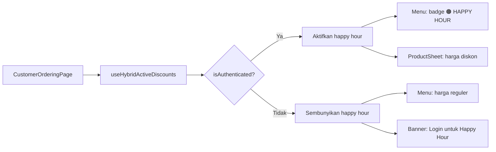

# Happy Hour Khusus Member (Login/Register)

**Date:** 2026-06-08  
**Status:** Planning  
**Author:** Zantara Agent

---

## Goal

Saat ini happy hour di customer app berlaku untuk SEMUA pengguna (guest maupun member). Target: happy hour hanya untuk customer yang **login/register**. Guest tetap lihat harga reguler.

---

## Current Context

### Bagaimana Happy Hour Bekerja Sekarang

```
Admin → /admin/discounts
  ├── isHappyHour: true
  ├── Jadwal: days[], startTime, endTime
  ├── Harga flat per produk (productPrices[])
  └── Tidak ada flag member-only

Customer App → CustomerOrderingPage
  ├── useHybridActiveDiscounts() → semua diskon aktif
  ├── calculateEffectivePrice(product, discounts) → happy hour berlaku
  └── Guest & member sama-sama dapat harga happy hour ✅❌
```

### Database

- **View:** `pos_active_discounts` — semua diskon aktif
- **Field happy hour:** `isHappyHour: boolean`, `productPrices: [{productId, price}]`
- **Tidak ada field** `isMemberOnly` atau `customerRequired`

### Customer App Flow



---

## Proposed Approach

### Option A: Filter di Frontend (Dipilih ✅)

**Filosofi:** Filter diskon happy hour di `CustomerOrderingPage` berdasarkan status `isAuthenticated`. Tidak perlu perubahan database.

**Pros:**
- ✅ Minimal code change (1 file utama + 2 file UI)
- ✅ Tidak perlu migration database
- ✅ Tidak perlu deploy Edge Function
- ✅ Mudah di-rollback
- ✅ Happy hour tetap utuh di POS/admin — hanya customer app yg di-filter

**Cons:**
- ❌ Tidak ada flag "happy hour untuk semua" — kalau mau ada happy hour yang untuk semua juga, perlu approach berbeda

### Option B: Tambah Field `isMemberOnly` di Database

**Filosofi:** Tambah field `isMemberOnly` di tabel diskon, admin bisa pilih "untuk member saja" per diskon.

**Pros:**
- ✅ Lebih fleksibel
- ✅ Admin kontrol penuh

**Cons:**
- ❌ Perlu migration DB
- ❌ Perlu update admin form
- ❌ Perlu update Edge Function/kode landing
- ❌ Over-engineering untuk MVP

### ✅ Keputusan: Option A untuk MVP

---

## Step-by-Step Plan

### Step 1: Filter Diskon di `customer-ordering-page.tsx`

**File:** `/opt/djiwatentramapp/apps/customer/src/components/customer/customer-ordering-page.tsx`

**Changes:**
- Tambah `useMemo` untuk filter happy hour:
```tsx
const memberDiscounts = useMemo(() => {
    if (!discounts) return undefined;
    if (!isAuthenticated) {
        return discounts.filter((d: any) => !d.isHappyHour);
    }
    return discounts;
}, [discounts, isAuthenticated]);
```
- Ganti props `discounts` → `memberDiscounts` di:
  - `renderMenuSection({ discounts: memberDiscounts, ... })`
  - `<ProductSheet discounts={memberDiscounts} ... />`
  - `calculateEffectivePrice()` di bagian checkout
  - `activeFreeRefillPromo` (free refill tetap untuk semua — TIDAK di-filter)

### Step 2: Banner "Login untuk Happy Hour" di Menu

**File:** `/opt/djiwatentramapp/apps/customer/src/components/customer/menu-section.tsx`

**New prop:** `showHappyHourBanner?: boolean`  
**Trigger:** `showHappyHourBanner = isAuthenticated === false && ada happy hour aktif`

**Banner component:**
```
┌─────────────────────────────────┐
│ 🟠 Happy Hour sedang berlangsung!│
│ Masuk/Daftar untuk harga spesial │
│         [Masuk / Daftar]         │
└─────────────────────────────────┘
```
- Background: amber/gradient
- Tombol: buka AuthModal
- Di atas katalog menu (sebelum category tabs)

### Step 3: Indikator di ProductSheet

**File:** `/opt/djiwatentramapp/apps/customer/src/components/customer/product-sheet.tsx`

**New prop:** `isHappyHourLocked?: boolean`

- Saat `isHappyHourLocked=true`:
  - Harga reguler ditampilkan normal
  - Ada badge/lock icon: `🔒 Harga spesial untuk member`
  - Harga happy hour tidak dihitung (pricing tetap pakai original price)

### Step 4: Deteksi Happy Hour Aktif

**File:** `/opt/djiwatentramapp/apps/customer/src/components/customer/customer-ordering-page.tsx`

**Tambah derived state:**
```tsx
const hasActiveHappyHour = useMemo(() => {
    if (!discounts) return false;
    // Cek apakah ada happy hour yang aktif untuk jam sekarang
    const now = new Date();
    const context = {
        currentTimestamp: now.getTime(),
        currentDay: now.getDay(),
        currentTimeVal: now.getHours() * 60 + now.getMinutes(),
    };
    return discounts.some((d: any) => 
        d.isHappyHour && isDiscountApplicable(d, context)
    );
}, [discounts]);
```

Diperlukan import `isDiscountApplicable` dari `@/lib/utils/pricing` atau buat fungsi inline.

---

## Files Changed

| File | Perubahan | Kompleksitas |
|------|-----------|-------------|
| `customer-ordering-page.tsx` | Tambah `useMemo` filter + `hasActiveHappyHour` + ganti 4 props | 🟡 Sedang (~30 baris) |
| `menu-section.tsx` | Tambah banner + prop `showHappyHourBanner` + event handler login | 🟡 Sedang (~40 baris) |
| `product-sheet.tsx` | Tambah badge "🔒 Login untuk harga spesial" + prop `isHappyHourLocked` | 🔵 Mudah (~20 baris) |
| `types.ts` (customer) | Tambah `MenuSectionProps` field baru | 🔵 Sangat mudah (~5 baris) |

---

## UI/UX Specification

### Menu Section — Banner Happy Hour (Guest)

```
┌──────────────────────────────────────────────────────┐
│                                                        │
│  🟠  ╔══════════════════════════════════════════╗      │
│      ║  🎉 Happy Hour sedang berlangsung!       ║      │
│      ║  Masuk/Daftar untuk dapatkan harga       ║      │
│      ║  spesial hingga Rp 15.000!               ║      │
│      ║                                          ║      │
│      ║  [ 🔒 Masuk / Daftar ]                   ║      │
│      ╚══════════════════════════════════════════╝      │
│                                                        │
│  [Menu 1] [Menu 2] [Menu 3] ← kategori tabs           │
│  ┌──────┐ ┌──────┐ ┌──────┐                           │
│  │ item │ │ item │ │ item │ ← harga REGULER           │
│  └──────┘ └──────┘ └──────┘                           │
└──────────────────────────────────────────────────────┘
```

**States:**
| State | Tampilan |
|-------|----------|
| Guest + happy hour aktif | Banner 🟠 + tombol login, menu harga reguler |
| Member + happy hour aktif | Badge 🟠 "HAPPY HOUR" pada produk, banner HILANG |
| Tidak ada happy hour | Normal, tidak ada banner |

### Product Sheet — Happy Hour Locked (Guest)

```
┌──────────────────────────────────┐
│          [gambar produk]          │
│                                   │
│  Nama Produk                      │
│  Deskripsi produk...              │
│                                   │
│  Rp 25.000                        │
│  🔒 Harga spesial Rp 15.000       │
│     untuk member                  │
│                                   │
│  [-] 1 [+]  Tambah ke keranjang   │
└──────────────────────────────────┘
```

### Product Sheet — Happy Hour Active (Member)

```
┌──────────────────────────────────┐
│          [gambar produk]          │
│  🟠 HAPPY HOUR                    │
│                                   │
│  Nama Produk                      │
│  Deskripsi produk...              │
│                                   │
│  Rp 15.000  Rp 25.000 ~~coret~~   │
│                                   │
│  [-] 1 [+]  Tambah ke keranjang   │
└──────────────────────────────────┘
```

---

## Data Flow

```
useHybridActiveDiscounts() → discounts[]
                                    │
                    ┌───────────────┴───────────────┐
                    │                               │
              isAuthenticated?                 isAuthenticated?
                    │                               │
              ┌─────┴─────┐                  ┌──────┴──────┐
              │           │                  │             │
             Yes         No                Yes            No
              │           │                  │             │
         memberDiscounts =              hasActiveHappyHour
         semua diskon    filter out      = true          = false
                         isHappyHour
              │           │                  │             │
              │           │              show banner    no banner
              ▼           ▼                  ▼             ▼
        menu: badge 🟠  menu: harga     menu: banner   menu: normal
        harga diskon    reguler          + tombol login
```

---

## Risks & Mitigations

| Risk | Mitigation |
|------|-----------|
| Guest frustrasi lihat harga reguler | Banner jelaskan benefit login, dorong registrasi |
| Happy hour tiba-tiba berubah | Data dari Supabase live, realtime update |
| Free refill salah di-filter | Free refill TETAP untuk semua — jangan di-filter bareng happy hour |
| Build error | Verifikasi dengan `bun run --cwd apps/customer build` |
| Tab corruption dari patch | Pakai `execute_code` + Python `open()` untuk edit file |

---

## Verification

1. **Build:** `bun run --cwd apps/customer build` — 0 error
2. **Guest flow:** Buka `/order` tanpa login → harga reguler, banner happy hour muncul
3. **Member flow:** Login → harga happy hour aktif, badge 🟠 muncul
4. **Non-happy hour:** Tidak ada perubahan tampilan
5. **Free refill:** Tetap untuk semua user
