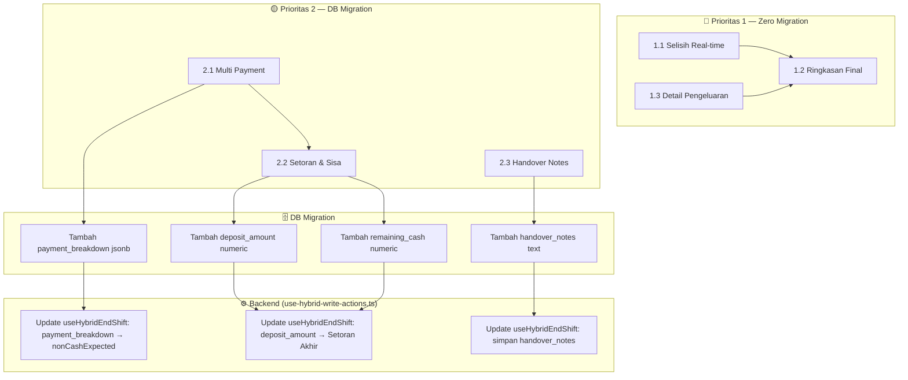

# Plan: Tutup Kasir — Integrasi Keuangan & Operasional

## Tujuan
Meningkatkan form tutup kasir di POS dengan fitur yang terintegrasi penuh ke sistem keuangan (financial_transactions, shifts) dan operasional (laporan harian, export, notifikasi Telegram).

---

## Arsitektur Data Saat Ini

### DB: `pos.shifts`
```
source_id           text PK
shift_name          text
cashier_name        text
team_members        text          ← "Andi, Siti, Amir"
start_time          double precision
end_time            double precision
starting_cash       numeric
notes               text
summary             jsonb         ← {cashRevenue, qrisRevenue, totalRevenue, totalExpenses, ...}
cash_breakdown      jsonb         ← {bill100000: 2, bill50000: 5, ...}
non_cash_expected   numeric
non_cash_confirmed  numeric       ← total QRIS/EDC dari dashboard
ending_cash_expected numeric     ← starting_cash + cashRevenue - totalExpenses
ending_cash_physical numeric     ← uang fisik di laci
creation_time       double precision
raw                 jsonb         ← {closingTasks: ...}
```

### DB: `pos.financial_transactions`
```
source_id           text PK
tx_type             text          ← "income" | "expense"
amount              numeric
category            text          ← "Modal Awal", "Setoran Akhir", "Beli Es Batu", ...
description         text
tx_date             double precision
status              text
payment_method      text          ← "tunai", "qris", "transfer", ...
metadata            jsonb
creation_time       double precision
raw                 jsonb
```

### Alur Tutup Shift Saat Ini

```mermaid
flowchart LR
    A[POS: Isi Form Tutup Shift] --> B[useHybridEndShift]
    B --> C[Hitung ulang revenue/expense dari financial_transactions]
    C --> D[Update pos.shifts: end_time, ending_cash, non_cash, dll]
    D --> E[Buat transaksi Setoran Akhir amount=0]
    E --> F[Kirim email laporan (opsional)]
```

---

## Fitur & Integrasi

### 🔴 PRIORITAS 1 — Zero Migration (Frontend Only)

#### 1.1 Selisih Real-time

| Aspek | Detail |
|-------|--------|
| **File** | `menu-sidebar.tsx` — `ShiftManagement` component |
| **Trigger** | Saat input `cashInRegister` / `totalUangFisik` berubah |
| **Logika** | `selisih = endingCashPhysical - endingCashExpected` |
| **Tampilan** | Muncul di bawah input: `Selisih: Rp +15.000 ✅ (lebih)` |
| **Warna** | Hijau (±0-10rb), Kuning (10rb-50rb), Merah (>50rb) |
| **Data Source** | `shiftIncome - shiftExpense` (sudah dihitung di komponen) + `shiftStatus?.ongoingShift?.startingCash` |
| **Mail/Notif** | Ikut tercantum di `description` transaksi Setoran Akhir |

**Integrasi:**
- ✅ Keuangan: nilai selisih langsung dari perhitungan revenue/expense shift
- ✅ Operasional: kasir langsung tahu ada masalah sebelum submit

---

#### 1.2 Ringkasan Final (Konfirmasi Sebelum Submit)

| Aspek | Detail |
|-------|--------|
| **File** | `menu-sidebar.tsx` — `ShiftManagement` component |
| **UX** | Modal/overlay muncul setelah klik "Akhiri & Cetak", sebelum benar2 submit |
| **Isi** | Shift, Kasir, Tim per-role, Uang Fisik, QRIS, Expected, Selisih, Pengeluaran, Catatan |
| **Tombol** | `[Kembali]` dan `[✅ Akhiri & Cetak Laporan]` |
| **Data Source** | Semua state sudah ada di `ShiftManagement` |

**Integrasi:**
- ✅ Operasional: double-check oleh kasir mengurangi human error
- ✅ Keuangan: semua angka final terverifikasi sebelum masuk DB

---

#### 1.3 Detail Pengeluaran Shift

| Aspek | Detail |
|-------|--------|
| **File** | `menu-sidebar.tsx` — `ShiftManagement` component |
| **Data** | Filter `todayTransactions` tipe "expense" + "completed" selama shift ini |
| **Tampilan** | Card/list di atas form pecahan uang: `Beli es batu: Rp 20.000\nBeli galon: Rp 17.000` |
| **Sudah ada** | `sExpenseVal` dihitung di komponen, tinggal ditampilkan |
| **Juga di** | `shift-report.tsx` (detail view), `home.lazy.tsx` (summary text), `yumi-ai-bot` (Telegram report) |

**Integrasi:**
- ✅ `pos.financial_transactions` — sumber data pengeluaran
- ✅ `pos_shift_reports` view — total_expenses sudah dihitung
- ✅ `export-utils.ts` — kolom pengeluaran sudah ada di export
- ✅ Laporan harian & Telegram — konsisten

---

### 🟡 PRIORITAS 2 — Butuh DB Migration

#### 2.1 Multi Payment Non-Tunai

| Aspek | Detail |
|-------|--------|
| **Masalah** | `nonCashConfirmed` cuma 1 field → QRIS, Debit, E-Wallet tercampur |
| **Solusi** | Ganti jadi JSONB atau tambah kolom per metode |
| **DB Schema** | Tambah kolom `payment_breakdown jsonb` di `pos.shifts` |
| **Format** | `{"qris": 200000, "debit": 90000, "gopay": 50000}` |
| **Frontend** | `menu-sidebar.tsx`: 1 field → 3-4 input per metode |
| **Admin** | `shift-report.tsx`: kolom QRIS → pecah jadi kolom per metode |
| **Export** | `export-utils.ts`: update kolom export |
| **Backend** | `useHybridEndShift`: hitung ulang `nonCashExpected` dari payment_breakdown |

**Integrasi:**
- ✅ Keuangan: rekonsiliasi sama dashboard provider (Mayar/EDC) lebih akurat
- ✅ `pos.shifts` — kolom baru `payment_breakdown`
- ✅ `pos.financial_transactions` — payment_method sudah beda tiap row

---

#### 2.2 Setoran & Sisa Laci

| Aspek | Detail |
|-------|--------|
| **Masalah** | Kasir setor semua uang → shift berikutnya harus ambil modal baru |
| **Solusi** | Input "Setor ke Owner" dan "Sisa Laci" |
| **DB Schema** | Tambah `deposit_amount numeric`, `remaining_cash numeric` di `pos.shifts` |
| **Frontend** | `menu-sidebar.tsx`: 2 input baru, validasi `deposit + remaining = endingCashPhysical` |
| **Admin** | `shift-report.tsx`: tampilkan deposit & sisa |
| **Export** | `export-utils.ts`: update kolom |
| **Keuangan** | `Setoran Akhir` transaction amount jadi = `deposit`, bukan 0 |

**Integrasi:**
- ✅ Keuangan: `Setoran Akhir` transaksi sekarang punya nominal real
- ✅ `pos.shifts` — kolom baru
- ✅ Operasional: shift berikutnya langsung tahu sisa modal

---

#### 2.3 Handover Notes

| Aspek | Detail |
|-------|--------|
| **Masalah** | Catatan shift tercampur historis vs operasional |
| **Solusi** | Pisah `notes` (historis) dengan `handover_notes` (untuk shift berikutnya) |
| **DB Schema** | Tambah `handover_notes text` di `pos.shifts` |
| **Frontend** | `menu-sidebar.tsx`: 2 textarea terpisah |
| **Admin** | `shift-report.tsx`: tampilkan handover notes |
| **Notif** | `yumi-ai-bot`: include handover notes di notif shift selesai |

**Integrasi:**
- ✅ Operasional: komunikasi antar shift jadi terstruktur
- ✅ Telegram bot: notifikasi include handover
- ✅ `pos.shifts` — kolom baru

---

## Files yang Akan Diubah

| # | File | Fitur | Prioritas |
|---|------|-------|-----------|
| 1 | `menu-sidebar.tsx` | Selisih real-time, Ringkasan final, Detail pengeluaran, Multi payment, Setoran & sisa, Handover notes | ALL |
| 2 | `shift-report.tsx` | Detail pengeluaran (detail view), Multi payment (kolom+detail), Setoran & sisa (detail), Handover notes | P1-P3 |
| 3 | `home.lazy.tsx` | Detail pengeluaran (summary text) | P1 |
| 4 | `use-hybrid-write-actions.ts` | `useHybridEndShift`: update logic Setoran Akhir, simpan payment_breakdown/deposit/handover | P2-P3 |
| 5 | `export-utils.ts` | Update kolom export CSV/PDF/JPG | P2-P3 |
| 6 | `yumi-ai-bot/app.py` | Include handover notes di notif Telegram | P3 |
| 7 | Supabase Migration | Tambah kolom `payment_breakdown`, `deposit_amount`, `remaining_cash`, `handover_notes` | P2-P3 |

---

## Dependency Graph



---

## Wave Planning

### Wave 1: 🔴 P1 — 20 menit
Subagent kerjakan `menu-sidebar.tsx`:
- Selisih real-time (di samping input uang fisik)
- Detail pengeluaran (card di atas pecahan)
- Ringkasan final (modal konfirmasi)

Kamu reconcile hasilnya.

### Wave 2: 🟡 P2 — 30 menit
- Subagent 1: Migration SQL + `useHybridEndShift` update
- Subagent 2: `shift-report.tsx` update kolom + detail
- Subagent 3: `export-utils.ts` + `yumi-ai-bot` update

Kamu: reconcile + deploy.

---

## Catatan

- Semua fitur P1 (zero migration) bisa dikerjakan kapan saja tanpa downtime
- Fitur P2-P3 butuh migration → perlu `supabase migration new` + deploy
- Data shift lama tetap kompatibel (kolom baru nullable)
- Seluruh perubahan mengikuti format per-role team members yang sudah ada
